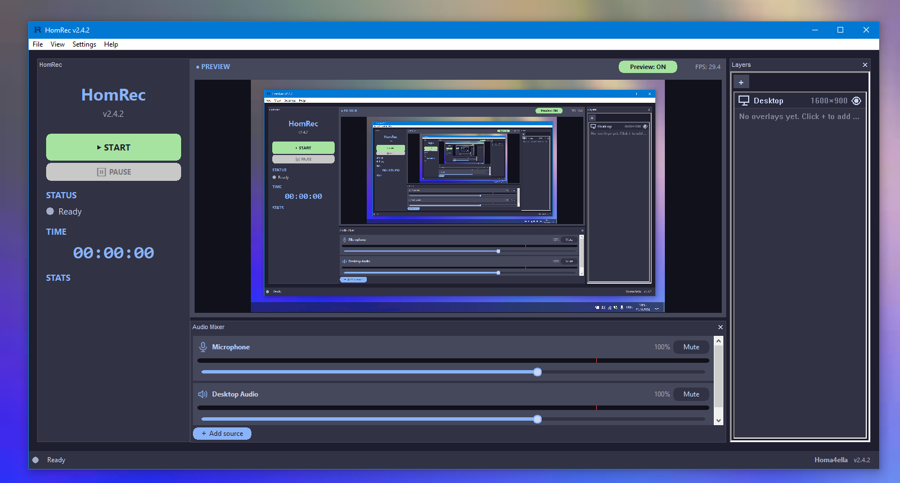

# HomRec (Hardware Optimized Mechanism Recorder)

[](https://github.com/homaaio/HomRec/releases)
[-0078d4?style=flat-square&logo=windows)](#system-requirements)
[](LICENSE)
[](https://discord.gg/Gv4t6Xhy7E)
[](https://t.me/homaexe)
[](https://boosty.to/homa4ella/donate)



A native C/C++ screen recorder for low-spec Windows machines. FFmpeg for encoding, no GPU requirement, no background services. Free and open source (GPLv3) - no activation, no license keys, no paid features.

## Contents

- [Overview](#overview)
- [Features](#features)
- [System requirements](#system-requirements)
- [Installation](#installation)
  - [Installer](#installer)
  - [Portable](#portable)
  - [From source](#from-source)
- [Usage](#usage)
  - [Interface and panels](#interface-and-panels)
  - [Window capture](#window-capture)
  - [Keyboard shortcuts](#keyboard-shortcuts)
  - [Presets and settings files](#presets-and-settings-files)
  - [Custom languages](#custom-languages)
  - [Console](#console)
  - [Console startup scripts](#console-startup-scripts)
- [Plugins](#plugins)
- [Diagnostics and troubleshooting](#diagnostics-and-troubleshooting)
- [Development](#development)
  - [Build dependencies](#build-dependencies)
  - [Project layout](#project-layout)
  - [Tests](#tests)
  - [Packaging and releases](#packaging-and-releases)
- [Contributing](#contributing)
- [License](#license)
- [Support & community](#support--community)

## Overview

HomRec targets a specific problem: general-purpose screen recorders (OBS, Bandicam) assume more CPU/GPU headroom than a lot of real-world machines have. HomRec is built to avoid that assumption entirely - no compositor, no GPU dependency, no background services beyond what active recording requires.

The application is 100% native C/C++: UI (wxWidgets), capture pipeline, audio, plugin host (Lua 5.4), and console all compile into `hr.exe`. At runtime it needs FFmpeg for encoding and the runtime `.dll` files that ship beside it (wxWidgets and the MinGW runtime); the installer and the portable archive include both. Note that this refers to the *application* - a small number of Python scripts exist under `tools/` for maintainer use (build packaging, environment checking, language file conversion) and are not part of `hr.exe` or required to run it.

HomRec is currently **Windows-only**: the capture engine uses DXGI/D3D11/Win32. Linux (X11 and Wayland) is planned but there is no Linux build yet - see [`src/platform/linux/`](src/platform/linux/x11/README.md) for the intended design.

## Features

- **Video capture** - full desktop, a chosen monitor, or a specific window; output scaled or at an exact resolution
- **Encoding** - automatic hardware-encoder detection (NVENC, AMD AMF, Intel Quick Sync) with software fallback (libx264/libx265); MP4, MKV, or both
- **Audio capture** - microphone and/or desktop audio (WASAPI loopback), combined or exported as separate tracks
- **Audio Mixer** - dockable mixer with horizontal or vertical layout; add extra microphones, browser or per-application audio (Windows 10 2004+), or audio files; per-source mute, volume, rename and auto-reconnect
- **Dockable interface** - rearrange, float, lock and reset the Controls, Audio Mixer and Overlays panels; layout is remembered
- **Multi-monitor support** - select which display to record
- **Overlays** - text, image, GIF, webcam, and an input overlay (on-screen keypress/mouse-click display); each overlay is placed and configured in a visual editor (position, size, opacity, font, files)
- **Instant Replay** - background rolling buffer, saved on demand via hotkey, independent of active recording
- **Hotkeys** - start/stop, pause/resume, fullscreen toggle, save-replay, all user-rebindable
- **Presets** - keep several named `.hrc` settings profiles and switch between them (File > Set Preset...), plus Export/Import Settings
- **Custom languages** - `.hrl` translation files, applied without restarting
- **Plugin system** - Lua-scripted, filesystem/network access, lifecycle and overlay hooks, plus the `hom` plugin package manager
- **Console** - built-in command console with optional autorun scripts
- **GPU-assisted capture** - unchanged desktop frames are skipped, only the changed screen region is read back and re-converted, and with a hardware encoder the D3D11 video processor scales + converts to NV12 on the GPU (Settings > Video > GPU colour conversion). Optional full-GPU capture + encode through ffmpeg 6+ `ddagrab` (experimental; no overlays/plugins/pause) - falls back to the normal pipeline automatically
- **Performance controls** - live preview can be disabled at the pipeline level (not just hidden in the UI), with independently adjustable preview resolution/FPS when left on
- **Diagnostics** - log viewer, PC analytics (CPU/RAM/disk), optional system and plugin logs, and a crash handler that writes a `.dmp` you can attach to a bug report
- **System integration** - system tray, always-on-top, desktop shortcut, launch-at-startup, in-app self-update

## System requirements

| Component | Minimum |
|---|---|
| OS | Windows 10 (64-bit) or later |
| CPU | Intel Core i3-M370 or equivalent |
| RAM | 2 GB or more recommended |
| Graphics | Integrated (Intel HD Graphics) or dedicated GPU, DirectX 10 |
| Disk | ~170 MB for installation + space for recordings |

These figures are estimates - if HomRec runs (or doesn't) on hardware below them, please [tell us](SUPPORT.md).

Some features need a newer Windows 10 build: whole-window capture needs 1903+ (older systems use the screen-crop method), and per-application audio capture needs 2004+. An elevated (admin) window can't be captured by a non-elevated HomRec - the screen crop is used instead - and a minimised window produces no new frames.

## Installation

### Installer

1. Download `homrec-setup-win64-<version>.exe` from [Releases](https://github.com/homaaio/HomRec/releases).
2. Run it. Installs per-user (`%LOCALAPPDATA%\Programs\HomRec`), no admin rights required.
3. Optional tasks (all off by default): desktop shortcut, launch at Windows startup, and associating `.hrc` (settings) and `.hrp` (plugin package) files with HomRec. The first two can also be changed later in Settings > System.

The installer registers a standard uninstaller (Windows Settings > Apps); it asks once whether to also delete `homrec.hrc` and `logs\` - your recordings are never touched. Installed copies can update in-app via Help > Check for Updates, which downloads the latest release's Setup exe and upgrades in place - no need to re-run the installer by hand.

### Portable

1. Download the latest `.zip` or `.7z` from [Releases](https://github.com/homaaio/HomRec/releases).
2. Extract to any location.
3. Run `hr.exe`. FFmpeg and the required `.dll` files are included in the archive.

Settings (`homrec.hrc`), logs and plugins live next to `hr.exe`, so keep them if you replace the files with a newer version.

**Note on antivirus warnings:** some antivirus products (reported with Kaspersky and Avast) flag `hr.exe` heuristically as a new/unsigned binary. This is a false positive - the source is public in this repository. Add an exception if needed.

### From source

Requirements: an MSYS2 MinGW-w64 toolchain, wxWidgets 3.2 (MSW, Unicode, DLL build) and Lua 5.4 (headers + library). See [Build dependencies](#build-dependencies).

```bash
git clone https://github.com/homaaio/HomRec.git
cd HomRec
```

Install the toolchain and wxWidgets (via [MSYS2](https://www.msys2.org/), MinGW-w64 shell):
```bash
pacman -S mingw-w64-x86_64-toolchain mingw-w64-x86_64-wxwidgets3.2-msw
```

Obtain Lua 5.4 - the amalgamation or binaries from [lua.org](https://www.lua.org/download.html) (the Makefile expects `C:/lua54/include` and `C:/lua54/lib` by default), or:
```bash
vcpkg install lua:x64-mingw-dynamic
```
Point the build at a different location with the Makefile's `LUA_CFLAGS`/`LUA_LDFLAGS` variables.

Build:
```bash
make            # hr.exe
make hom        # optional: hom.exe, the plugin package manager
```

The Makefile assumes MSYS2 is installed at `C:\msys64` (wxWidgets paths are set at the top of the file). A CMake build that mirrors the Makefile is also provided, with the paths exposed as cache variables:
```bash
cmake -B build -G "MinGW Makefiles" -DLUA_INCLUDE_DIR=C:/lua54/include -DLUA_LIB_DIR=C:/lua54/lib
cmake --build build
```
Both build systems list the source files by hand - when you add or remove a `.cpp`, update **both** `Makefile` and `CMakeLists.txt`.

To run: `hr.exe` links wxWidgets dynamically, so the wxWidgets/Lua `.dll` files from your toolchain must sit next to it (or be on `PATH`). FFmpeg is looked for next to `hr.exe`, in its `ffmpeg\` or `bin\` subfolder, in a few common `C:\` locations, and on `PATH`; ffmpeg 6+ is needed for the experimental `ddagrab` option.

```bash
hr.exe
```

To reproduce the installer itself, see [`installer/README.md`](installer/README.md).

## Usage

### Interface and panels

The preview sits in the centre; **Controls** (Start/Pause/status/time), **Audio Mixer** and **Overlays** are panels around it. Drag a panel's title bar to dock it on any side, or drop it outside the window to float it. Use **View > Move panel to** (Left, Right, Top, Bottom, Floating window), **View > Lock layout** to freeze everything, and **View > Reset layout** to return to the default. The layout is saved between sessions.

Add an extra audio source with **+ Add source** in the Audio Mixer; pick horizontal or vertical strips in Settings > Audio > Mixer layout. Extra sources are not included in Instant Replay.

### Window capture

Choose **File > Select Window...** to record a single window. By default HomRec uses Windows Graphics Capture so the whole window is recorded regardless of what covers it; if the window is resized while recording, the picture is fitted into the recording's fixed size (aspect kept, black bars). Under Settings > General > Window capture you can switch the method between `auto` and `crop` (the older screen-region crop) and choose whether to capture the whole window or only its client area.

### Keyboard shortcuts

| Key (default) | Action |
|---|---|
| `F9` | Start / Stop recording |
| `F10` | Pause / Resume recording |
| `F11` | Toggle HomRec's own window fullscreen |
| `F8` | Save Instant Replay |

All shortcuts are configurable in Settings > Hotkeys.

### Presets and settings files

Settings are stored in `homrec.hrc` next to `hr.exe`. **File > Set Preset...** manages several named `.hrc` profiles (kept in a `presets\` folder) and switches between them; a preset can also be a partial file, such as one containing only overlays. Export and Import Settings handle one-off files.

### Custom languages

Language files use the `.hrl` format (compressed JSON, keyed against the built-in English template).

To install: Settings > General > **Add Language...** > select file > **Save**. Applies immediately, no restart required.

To create one: use `tools/hrl_tool.py` to pack/unpack `.hrl` files against plain JSON:

```bash
python tools/hrl_tool.py unpack en.hrl en.json    # export a template to translate
python tools/hrl_tool.py pack   xx.json xx.hrl    # build your .hrl
```

Community translations are commonly shared via Discord.

### Console

HomRec has a built-in developer console for scripting and diagnostics. Commands include `status`, `info`, `log`, `echo`, `alias`, `batch` and `hom` (the plugin manager, see [Plugins](#plugins)), and anything not built in is passed to loaded plugins. `ls` lists files - `ls .` shows the HomRec folder, `ls plugins` any folder, and `ls plugins/name.hrp` the contents of a plugin package without extracting it (a bare `ls` still lists console aliases).

Most settings are also exposed as console variables by key (for example `ui_locked = 1`), and by the same keys in `.hrc` files, cfg scripts and plugins. See [`docs/commands/Commands.md`](docs/commands/Commands.md) for the command reference and the [documentation page](docs/documentation.html) for the console, config scripts, plugins and `hom`.

### Console startup scripts

Two optional, plain-text script files under `cfg/` (auto-created next to `hr.exe` on first run):

| File | Runs when |
|---|---|
| `autoexec.cfg` | Every application launch |
| `startrec.cfg` | Start of every recording |

Format: one console command per line; `//` or `#` for comments. Copy `autoexec.cfg.example` / `startrec.cfg.example` to try them. See [`cfg/README.md`](cfg/README.md) for details.

## Plugins

Plugins are written in Lua and packaged as a directory under `plugins/`:

```
plugins/
  my_plugin/
    plugin.json     { "id": "my_plugin", "name": "My Plugin", "version": "1.0", "entry": "main.lua" }
    main.lua
```

Plugin code has full filesystem and network access (`io`, `os`, `homrec.http_get`/`http_post`), a `homrec.*` API (toasts, color helpers, cross-plugin events), and lifecycle hooks:

| Hook | Called when |
|---|---|
| `on_load` / `on_unload` | The plugin is loaded / unloaded |
| `on_recording_start` / `on_recording_stop` | A recording starts / stops |
| `on_replay_saved` | An Instant Replay clip is saved |
| `on_overlay_added` / `on_overlay_removed` | An overlay is added / removed |
| `on_custom_event` | Another plugin raises an event |

Given this access level, only install plugins from trusted sources. Plugin output is logged to `logs/plugins.log` (toggle in Settings > Security).

A packaged plugin (`.hrp`, a renamed `.zip`) can be installed by:
- placing it in `plugins/` manually and restarting HomRec, or
- **File > Import Plugin (.hrp)...** in the app, which loads it without a restart, or
- `hom install <plugin-name>`, using the `hom` package manager

**`hom`** is a small command-line package manager for `.hrp` plugins (`hom.exe`, kept next to `hr.exe`; prebuilt in [`Hom/`](Hom), or `make hom`). Besides `install`, it supports `search`, `show`, `list`, `upgrade`, `remove` and `purge`, and can update itself with `hom update`. It also runs inside HomRec's console. See [`Hom/README.md`](Hom/README.md) for the full command list.

For the plugin API, see the plugins section of the [documentation page](docs/documentation.html).

## Diagnostics and troubleshooting

- **Logs** are written under `logs/` next to `hr.exe`; system logging and plugin logging can be toggled in Settings > Security.
- **Crashes** produce a `.dmp` file and a log entry - please attach both to a bug report.
- **Environment check:** `python tools/homrec_check.py` inspects RAM, Windows version, GPU, disk space, FFmpeg, your settings, cfg scripts, plugins and recent logs, and runs a short smoke test.
- **Antivirus** flagging `hr.exe` is a known false positive - see [Portable](#portable).
- **Bug reports** are most useful with your HomRec version, Windows version, steps to reproduce, and a log or screenshot - see [`SUPPORT.md`](SUPPORT.md) or open an [issue](https://github.com/homaaio/HomRec/issues).

## Development

### Build dependencies

| Dependency | Needed for |
|---|---|
| MinGW-w64 toolchain (g++, gcc, windres, make) | building `hr.exe` and `hom.exe` |
| wxWidgets 3.2 (MSW, Unicode, DLL build) | UI - links `aui`, `xrc`, `html`, `qa`, `core`, `base`, `xml`, `net` |
| Lua 5.4 (headers + library) | plugin host |
| FFmpeg | runtime encoding (6+ for `ddagrab`) |
| CMake 3.15+ | optional alternative to `make` |
| Python 3 | optional maintainer scripts in `tools/` |
| Inno Setup 6 | optional, building the installer |

### Project layout

```
src/
  core/        capture (DXGI, WGC), pipeline, audio, overlays, settings, hotkeys
  ui/          wxWidgets UI: main window, dialogs, panels, settings, console window
  utils/       logging, crash handler, updater, system integration, archives
  plugins/     Lua engine and the homrec.* API
  commands/    console commands (ls)
  platform/    placeholders for future Linux (X11 / Wayland) capture
ffmpeg/        ffmpeg process runner
Hom/           prebuilt hom.exe and its version file
tools/         hom source, homrec_build.py, homrec_check.py, hrl_tool.py
installer/     Inno Setup script and notes
cfg/           example console startup scripts
docs/          project website and command reference
scripts/tests/ unit tests
icons/         app, tray, overlay and mixer icons
```

### Tests

A small [doctest](https://github.com/doctest/doctest) suite covers the pixel-conversion helpers; it needs no wxWidgets or Windows APIs:

```bash
g++ -O2 -c src/core/encoder_helpers.c -o /tmp/hr_encoder_helpers.o
g++ -std=c++17 -Iscripts/tests scripts/tests/test_encoder_helpers.cpp /tmp/hr_encoder_helpers.o -o /tmp/hr_tests.exe
/tmp/hr_tests.exe
```

### Packaging and releases

`python tools/homrec_build.py` builds the release archives into `dist\` and can optionally build the installer; the version is read from `src/ui/version.h` (`HR_APP_VERSION`), the single place to bump on release.

Pushing a version tag (for example `v2.4.0`) runs `.github/workflows/release.yml`, which creates the GitHub Release with notes taken from the matching `CHANGELOG.txt` section. It does not build binaries - attach the Setup exe to the release yourself, since in-app update checks look for a release asset ending in `.exe`.

## Contributing

Bug reports, translations (`.hrl`), plugins and code are all welcome. Fork the repository, make your change, and open a pull request against `main`; add yourself to [`CONTRIBUTORS.md`](CONTRIBUTORS.md) in the same PR. Use the issue templates for bugs and feature requests, and see [`SUPPORT.md`](SUPPORT.md) for other ways to get in touch.

## License

HomRec is released under the [GNU General Public License v3.0](LICENSE). By contributing you agree to license your contribution under the same terms.

## Support & community

- Releases: [github.com/homaaio/HomRec/releases](https://github.com/homaaio/HomRec/releases)
- Issues: [github.com/homaaio/HomRec/issues](https://github.com/homaaio/HomRec/issues)
- Telegram: [t.me/homaexe](https://t.me/homaexe)
- X: [x.com/homrec_dev](https://x.com/homrec_dev)
- Discord: [discord.gg/Gv4t6Xhy7E](https://discord.gg/Gv4t6Xhy7E)
- Support (Boosty): [Boosty](https://boosty.to/homa4ella/donate)

<div align="center">
Made with ❤️ by <b>homaaio</b>
</div>

