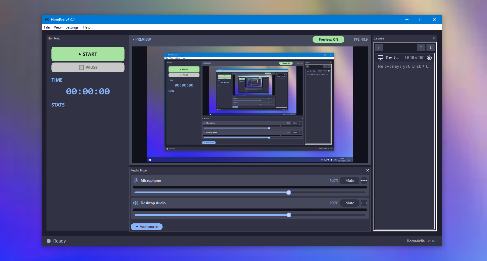

# HomRec (Hardware Optimized Mechanism Recorder)

[](https://github.com/homaaio/HomRec/releases)
[-0078d4?style=flat-square&logo=windows)](#системные-требования)
[](LICENSE)
[](https://discord.gg/Gv4t6Xhy7E)
[](https://t.me/homaexe)
[](https://boosty.to/homa4ella/single-payment/donation/837068/target?share=target_link)



Нативный экранный рекордер на C/C++ для слабых Windows-компьютеров. Для кодирования используется FFmpeg, видеокарта не требуется, фоновых служб нет. Бесплатный проект с открытым исходным кодом (GPLv3): без активации, без лицензионных ключей, без платных функций.

Английская версия: [README.md](README.md). Названия пунктов меню и настроек оставлены на английском, потому что именно так они выглядят в интерфейсе по умолчанию.

## Содержание

- [Обзор](#обзор)
- [Возможности](#возможности)
- [Системные требования](#системные-требования)
- [Установка](#установка)
  - [Установщик](#установщик)
  - [Портативная версия](#портативная-версия)
  - [Из исходников](#из-исходников)
- [Использование](#использование)
  - [Интерфейс и панели](#интерфейс-и-панели)
  - [Захват окна](#захват-окна)
  - [Горячие клавиши](#горячие-клавиши)
  - [Пресеты и файлы настроек](#пресеты-и-файлы-настроек)
  - [Пользовательские языки](#пользовательские-языки)
  - [Консоль](#консоль)
  - [Скрипты автозапуска консоли](#скрипты-автозапуска-консоли)
- [Плагины](#плагины)
- [Документация](#документация)
- [Диагностика и устранение неполадок](#диагностика-и-устранение-неполадок)
- [Разработка](#разработка)
  - [Зависимости для сборки](#зависимости-для-сборки)
  - [Структура проекта](#структура-проекта)
  - [Тесты](#тесты)
  - [Упаковка и релизы](#упаковка-и-релизы)
- [Участие в проекте](#участие-в-проекте)
- [Лицензия](#лицензия)
- [Поддержка и сообщество](#поддержка-и-сообщество)

## Обзор

HomRec решает конкретную проблему: универсальные рекордеры (OBS, Bandicam) рассчитывают на запас мощности CPU и GPU, которого у многих реальных компьютеров нет. HomRec строится без этого допущения: никакого композитора, никакой зависимости от GPU, никаких фоновых служб, кроме тех, что нужны во время записи.

Приложение на 100% нативное, на C/C++: интерфейс (wxWidgets), конвейер захвата, звук, хост плагинов (Lua 5.4) и консоль собираются в один `hr.exe`. Для работы нужны FFmpeg (кодирование) и `.dll` рантайма, лежащие рядом (wxWidgets и среда выполнения MinGW); установщик и портативный архив включают и то и другое. Это относится именно к *приложению*: в `tools/` есть несколько Python-скриптов для мейнтейнера (упаковка релизов, проверка окружения, конвертация языковых файлов), они не входят в `hr.exe` и для запуска не нужны.

Сейчас HomRec работает **только в Windows**: движок захвата использует DXGI/D3D11/Win32. Linux (X11 и Wayland) находится на ранней стадии подготовки в ветке `linux-raw`. Рабочего рекордера для Linux пока нет, есть только основа (интерфейсы платформы, команда `homrec doctor`, CI) и окно: `scripts/linux/build.sh` собирает `build-linux/hr` (wxGTK) с главным окном, настройками и окнами, которые от них открываются. Запись, предпросмотр, микшер и оверлеи показывают заглушки «not now». Подробности: [`docs/LINUX_PORT_PLAN.md`](docs/LINUX_PORT_PLAN.md).

## Возможности

- **Захват видео**: весь рабочий стол, выбранный монитор или конкретное окно; вывод с масштабированием или в точном разрешении
- **Кодирование**: автоматическое определение аппаратных кодировщиков (NVENC, AMD AMF, Intel Quick Sync) с запасным вариантом (libx264/libx265); запись в MP4, MKV или оба формата сразу
- **Захват звука**: микрофон и/или звук рабочего стола (WASAPI loopback), смешанные вместе или отдельными дорожками
- **Audio Mixer**: закрепляемый микшер с горизонтальной или вертикальной раскладкой; можно добавить дополнительные микрофоны, звук браузера или отдельных приложений (Windows 10 2004+), аудиофайлы; у каждого источника своё отключение звука, громкость, переименование и автопереподключение
- **Закрепляемый интерфейс**: панели Controls, Audio Mixer и Overlays можно переставлять, делать плавающими, блокировать и сбрасывать; раскладка запоминается
- **Несколько мониторов**: можно выбрать, какой экран записывать
- **Оверлеи**: текст, изображение, GIF, веб-камера и оверлей ввода (показ нажатий клавиш и кликов мыши на экране); каждый оверлей размещается и настраивается в визуальном редакторе (позиция, размер, прозрачность, шрифт, файлы)
- **Instant Replay**: фоновый кольцевой буфер, сохраняется по горячей клавише, не зависит от обычной записи
- **Горячие клавиши**: старт/стоп, пауза/продолжение, переключение полноэкранного режима, сохранение replay; все переназначаются
- **Пресеты**: несколько именованных профилей настроек `.hrc` с переключением между ними (File > Set Preset...), а также экспорт и импорт настроек
- **Пользовательские языки**: файлы перевода `.hrl`, применяются без перезапуска
- **Система плагинов**: на Lua, доступ к файловой системе и сети, хуки жизненного цикла и оверлеев, а также [`hom`](https://github.com/homaaio/hom), отдельный менеджер пакетов для плагинов
- **Консоль**: встроенная командная консоль с необязательными скриптами автозапуска
- **Захват с помощью GPU**: неизменившиеся кадры рабочего стола пропускаются, считывается и заново конвертируется только изменившаяся область экрана, а при аппаратном кодировщике видеопроцессор D3D11 масштабирует и конвертирует в NV12 на GPU (Settings > Video > GPU colour conversion). Есть необязательный режим полного захвата и кодирования на GPU через `ddagrab` из ffmpeg 6+ (экспериментальный; без оверлеев, плагинов и паузы); при невозможности он автоматически откатывается к обычному конвейеру
- **Управление производительностью**: живой предпросмотр можно отключить на уровне конвейера (а не просто скрыть в интерфейсе), а когда он включён, его разрешение и FPS настраиваются отдельно
- **Диагностика**: просмотр логов, PC analytics (CPU/RAM/диск), необязательные системные логи и логи плагинов, а также обработчик сбоев, который пишет `.dmp`-файл для отчёта об ошибке
- **Интеграция с системой**: трей, режим «поверх всех окон», ярлык на рабочем столе, запуск вместе с Windows, самообновление внутри приложения

## Системные требования

| Компонент | Минимум |
|---|---|
| ОС | Windows 10 (64-бит) или новее |
| CPU | Intel Core i3-M370 или аналог |
| RAM | рекомендуется 2 ГБ и больше |
| Графика | встроенная (Intel HD Graphics) или дискретная, DirectX 10 |
| Диск | около 170 МБ для установки + место под записи |

Эти цифры приблизительные. Если HomRec запускается (или не запускается) на более слабом железе, пожалуйста, [сообщите нам](SUPPORT.md).

Для некоторых функций нужна более новая сборка Windows 10: захват окна целиком требует 1903+ (на более старых системах используется способ с вырезанием части экрана), а захват звука отдельного приложения требует 2004+. Окно с правами администратора не может быть захвачено обычным HomRec (используется вырезание части экрана), а свёрнутое окно не выдаёт новых кадров.

## Установка

### Установщик

1. Скачайте `homrec-setup-win64-<версия>.exe` со страницы [Releases](https://github.com/homaaio/HomRec/releases).
2. Запустите его. Установка выполняется для текущего пользователя (`%LOCALAPPDATA%\Programs\HomRec`), права администратора не нужны.
3. Необязательные задачи (все по умолчанию выключены): ярлык на рабочем столе, запуск вместе с Windows и сопоставление файлов `.hrc` (настройки) и `.hrp` (пакет плагина) с HomRec. Первые две можно позже изменить в Settings > System.

Установщик регистрирует стандартный деинсталлятор (Параметры Windows > Приложения); он один раз спрашивает, удалять ли также `homrec.hrc` и `logs\`. Ваши записи он не трогает никогда. Установленная копия обновляется внутри приложения через Help > Check for Updates: оно скачивает Setup exe последнего релиза и обновляет программу на месте, запускать установщик вручную не нужно.

### Портативная версия

1. Скачайте последний `.zip` или `.7z` со страницы [Releases](https://github.com/homaaio/HomRec/releases).
2. Распакуйте в любое место.
3. Запустите `hr.exe`. Нужные `.dll` входят в архив. **FFmpeg входит только в «полный» архив** (`...-portable-full`); при обычном архиве `portable` положите `ffmpeg.exe` в папку `ffmpeg\` рядом с `hr.exe`, иначе HomRec сообщит «FFmpeg not found.» См. [Начало работы](docs/hr/getting-started.md).

Настройки (`homrec.hrc`), логи и плагины лежат рядом с `hr.exe`, поэтому сохраните их, если заменяете файлы более новой версией.

**Про предупреждения антивируса:** некоторые антивирусы (замечено у Kaspersky и Avast) эвристически помечают `hr.exe` как новый неподписанный файл. Это ложное срабатывание: исходный код открыт в этом репозитории. При необходимости добавьте исключение.

### Из исходников

Требования: набор инструментов MSYS2 **UCRT64**, wxWidgets 3.2 (MSW, Unicode, сборка DLL) и Lua 5.4 (заголовки и библиотека). См. [Зависимости для сборки](#зависимости-для-сборки). Используйте оболочку **MSYS2 UCRT64**: DLL, поставляемые с HomRec, и путь `C:/lua54` по умолчанию относятся к UCRT-сборкам, а смешивание их с набором MINGW64 (MSVCRT) приводит к ошибке на этапе линковки.

```bash
git clone https://github.com/homaaio/HomRec.git
cd HomRec
```

Установите набор инструментов и wxWidgets (через [MSYS2](https://www.msys2.org/), оболочка **UCRT64**):
```bash
pacman -S mingw-w64-ucrt-x86_64-toolchain mingw-w64-ucrt-x86_64-wxwidgets3.2-msw
```

Получите Lua 5.4: исходники (amalgamation) или бинарные файлы с [lua.org](https://www.lua.org/download.html) (по умолчанию сборка ищет `C:/lua54/include` и `C:/lua54/lib`), либо:
```bash
vcpkg install lua:x64-mingw-dynamic
```
Чтобы указать другое расположение, используйте `-DLUA_INCLUDE_DIR=... -DLUA_LIB_DIR=...` (см. ниже).

Сборка:
```bash
cmake -S . -B build -G "MinGW Makefiles"
cmake --build build -j                   # hr.exe и homrec.exe, записываются в корень репозитория
cmake --build build --target hr          # только hr.exe (другая цель: homrec)
```

CMake: единственная система сборки. Пути задаются переменными кэша (по умолчанию: MSYS2 в `C:\msys64`, Lua в `C:/lua54`; пути `WX_*` определяются по окружению MSYS2 того компилятора, который выбрал CMake), например `-DLUA_INCLUDE_DIR=D:/lua/include -DLUA_LIB_DIR=D:/lua/lib -DWX_LIB_DIR=...`. Параметр `-DHR_LTO=OFF` отключает оптимизацию при линковке (LTO), если линковка медленная или завершается ошибкой, а `-DHR_EXE_IN_ROOT=OFF` оставляет .exe-файлы в `build/`. Исходные файлы перечислены вручную в `CMakeLists.txt`: когда вы добавляете или удаляете `.cpp`, обновите этот список.

Модульные тесты и бенчмарк CPU (необязательно):
```bash
cmake -S . -B build -DHOMREC_BUILD_TESTS=ON
cmake --build build -j
ctest --test-dir build --output-on-failure
cmake --build build --target bench && build/bench.exe > run.txt && python tools/bench_compare.py run.txt
```

Запуск: `hr.exe` подключает wxWidgets динамически, поэтому `.dll` wxWidgets и Lua из вашего набора инструментов должны лежать рядом с ним (или быть в `PATH`). FFmpeg ищется рядом с `hr.exe`, в его подпапках `ffmpeg\` и `bin\`, в нескольких типичных местах на диске `C:\` и в `PATH`; для экспериментального режима `ddagrab` нужен ffmpeg 6+.

```bash
hr.exe
```

Как воспроизвести сам установщик, описано в [`installer/README.md`](installer/README.md).

## Использование

### Интерфейс и панели

Предпросмотр находится в центре; панели **Controls** (Start/Pause/статус/время), **Audio Mixer** и **Overlays** расположены вокруг него. Перетащите заголовок панели, чтобы закрепить её с любой стороны, или вынесите за пределы окна, чтобы сделать плавающей. **View > Move panel to** (Left, Right, Top, Bottom, Floating window) перемещает панель, **View > Lock layout** фиксирует всё на месте, а **View > Reset layout** возвращает раскладку по умолчанию. Раскладка сохраняется между сеансами.

Дополнительный источник звука добавляется кнопкой **+ Add source** в Audio Mixer; горизонтальные или вертикальные полосы выбираются в Settings > Audio > Mixer layout. Дополнительные источники в Instant Replay не попадают.

### Захват окна

Первая строка панели **Layers** это источник захвата: дважды щёлкните по ней, чтобы открыть окно **Capture source** и выбрать весь рабочий стол (и монитор), одно окно или область экрана. Для окна можно выбрать **The window itself** (Windows Graphics Capture: окно записывается целиком независимо от того, что его перекрывает), **A part of the screen** (вырезание части экрана) или **Smart mode**, а также указать, как HomRec будет снова находить окно (программа, класс окна, заголовок). Если размер окна меняется во время записи, картинка вписывается в фиксированный размер записи (пропорции сохраняются, добавляются чёрные полосы). Подробное руководство: [Источники захвата](docs/hr/capture-sources.md).

### Горячие клавиши

| Клавиша (по умолчанию) | Действие |
|---|---|
| `F9` | Старт / стоп записи |
| `F10` | Пауза / продолжение записи |
| `F11` | Полноэкранный режим окна HomRec |
| `F8` | Сохранить Instant Replay |

Все сочетания настраиваются в Settings > Hotkeys.

### Пресеты и файлы настроек

Настройки хранятся в `homrec.hrc` рядом с `hr.exe`. **File > Set Preset...** управляет несколькими именованными профилями `.hrc` (они лежат в папке `presets\`) и переключает их; пресет может быть и частичным файлом, например содержать только оверлеи. Для разовых файлов служат Export и Import Settings.

### Пользовательские языки

Языковые файлы имеют формат `.hrl` (сжатый JSON, ключи соответствуют встроенному английскому шаблону).

Установка: Settings > General > **Add Language...** > выберите файл > **Save**. Применяется сразу, перезапуск не нужен.

Создание: используйте `tools/hrl_tool.py`, чтобы упаковывать и распаковывать `.hrl` в обычный JSON и обратно:

```bash
python tools/hrl_tool.py unpack en.hrl en.json    # выгрузить шаблон для перевода
python tools/hrl_tool.py pack   xx.json xx.hrl    # собрать ваш .hrl
```

Переводы сообщества обычно делятся в Discord.

### Консоль

В HomRec есть встроенная консоль разработчика для скриптов и диагностики. Среди команд: `status`, `info`, `log`, `echo`, `alias`, `batch` и `hom` (менеджер плагинов, см. [Плагины](#плагины)); всё, чего нет среди встроенных команд, передаётся загруженным плагинам. `ls` показывает файлы: `ls .` выводит папку HomRec, `ls plugins` любую папку, а `ls plugins/name.hrp` содержимое пакета плагина без распаковки (просто `ls` по-прежнему показывает псевдонимы консоли).

Большинство настроек доступны как переменные консоли по ключу (например, `ui_locked = 1`) и по тем же ключам в файлах `.hrc`, cfg-скриптах и плагинах. Читать настройку можно свободно (`target_fps`); чтобы изменить её, нужен префикс `inwid` (`inwid target_fps = 60`), кроме скриптов в `cfg/`. Справочник команд: [`docs/commands/Commands.md`](docs/commands/Commands.md).

### Скрипты автозапуска консоли

Два необязательных текстовых файла-скрипта в `cfg/` (создаются рядом с `hr.exe` при первом запуске):

| Файл | Выполняется |
|---|---|
| `autoexec.cfg` | При каждом запуске приложения |
| `startrec.cfg` | В начале каждой записи |

Формат: одна команда консоли в строке; `//` или `#` для комментариев. Чтобы попробовать, скопируйте `autoexec.cfg.example` / `startrec.cfg.example`. Подробности: [`cfg/README.md`](cfg/README.md).

## Плагины

Плагины пишутся на Lua и оформляются как каталог в `plugins/`:

```
plugins/
  my_plugin/
    plugin.json     { "id": "my_plugin", "name": "My Plugin", "version": "1.0", "entry": "main.lua" }
    main.lua
```

Код плагина имеет полный доступ к файловой системе и сети (`io`, `os`, `homrec.http_get`/`http_post`), API `homrec.*` (всплывающие уведомления, работа с цветами, события между плагинами) и хуки жизненного цикла:

| Хук | Вызывается, когда |
|---|---|
| `on_load` / `on_unload` | Плагин загружен / выгружен |
| `on_recording_start` / `on_recording_stop` | Запись началась / закончилась |
| `on_replay_saved` | Клип Instant Replay сохранён |
| `on_overlay_added` / `on_overlay_removed` | Оверлей добавлен / удалён |
| `on_custom_event` | Другой плагин вызвал событие |

Из-за такого уровня доступа устанавливайте плагины только из надёжных источников. Вывод плагинов записывается в `logs/plugins.log` (включается в Settings > Security).

Упакованный плагин (`.hrp`, переименованный `.zip`) можно установить так:
- положить его в `plugins/` вручную и перезапустить HomRec, или
- через **File > Import Plugin (.hrp)...** в приложении (загружается без перезапуска), или
- командой `hom install <имя-плагина>` с помощью менеджера пакетов `hom`

**`hom`** это отдельный проект: небольшой менеджер пакетов для плагинов (`.hrp`, `.jar`), а сам по себе ещё и для файлов, архивов и программ. Он находится в [github.com/homaaio/hom](https://github.com/homaaio/hom) (исходный код, официальный список пакетов, `hom.exe` в [релизах](https://github.com/homaaio/hom/releases)). Установщик и портативный архив включают `hom.exe` рядом с `hr.exe`; консоль HomRec передаёт `hom ...` ему, а `hom restore` скачивает его заново, если он пропал. Поддерживаются `install`, `search`, `show`, `list`, `upgrade`, `remove`, `purge` и `update`; просто `hom` в терминале открывает полноэкранный обозреватель пакетов. Команды, типы пакетов и места, куда попадают файлы, описаны в его README.

API плагинов: [`docs/hr/plugins.md`](docs/hr/plugins.md).

## Документация

| Руководство | О чём |
|---|---|
| [Оглавление документации](docs/hr/README.md) | Отсюда начинайте: какая страница отвечает на какой вопрос |
| [Начало работы](docs/hr/getting-started.md) | Установка, первый запуск, первая запись |
| [Как это работает](docs/hr/how-it-works.md) | Что происходит от нажатия Start до готового файла и что может пойти не так на каждом шаге |
| [Устранение неполадок](docs/hr/troubleshooting.md) | Решения по симптомам |
| [Логи и диагностика](docs/hr/logs-and-diagnostics.md) | Файлы логов, дампы сбоев, отчёты об ошибках |
| [Документация hom](docs/hom/README.md) | Установка и использование менеджера пакетов для плагинов |

Документация написана на английском.

## Диагностика и устранение неполадок

- Пошаговые решения по симптомам: [`docs/hr/troubleshooting.md`](docs/hr/troubleshooting.md).
- **Логи** пишутся в `logs/` рядом с `hr.exe`; системные логи и логи плагинов включаются в Settings > Security.
- **Сбои** создают `.dmp`-файл и запись в логе; пожалуйста, прикладывайте оба к отчёту об ошибке.
- **Проверка окружения:** `python tools/homrec_check.py` смотрит RAM, версию Windows, GPU, место на диске, FFmpeg, ваши настройки, cfg-скрипты, плагины и свежие логи и запускает короткий smoke-тест.
- **Антивирус**, помечающий `hr.exe`, это известное ложное срабатывание, см. [Портативная версия](#портативная-версия).
- **Отчёты об ошибках** полезнее всего с версией HomRec, версией Windows, шагами воспроизведения и логом или скриншотом; см. [`SUPPORT.md`](SUPPORT.md) или откройте [issue](https://github.com/homaaio/HomRec/issues).

## Разработка

### Зависимости для сборки

| Зависимость | Для чего нужна |
|---|---|
| Набор инструментов MinGW-w64 (g++, gcc, windres, mingw32-make) | сборка `hr.exe` и `homrec.exe` |
| wxWidgets 3.2 (MSW, Unicode, сборка DLL) | интерфейс; подключаются `aui`, `xrc`, `html`, `qa`, `core`, `base`, `xml`, `net` |
| Lua 5.4 (заголовки и библиотека) | хост плагинов |
| FFmpeg | кодирование во время работы (6+ для `ddagrab`) |
| CMake 3.15+ | система сборки |
| Python 3 | необязательные скрипты мейнтейнера в `tools/` |
| Inno Setup 6 | необязательно, сборка установщика |

### Структура проекта

```
src/
  core/        захват (DXGI, WGC), конвейер, звук, оверлеи, настройки, горячие клавиши
  ui/          интерфейс wxWidgets: главное окно, диалоги, панели, настройки, окно консоли
  utils/       логирование, обработчик сбоев, обновление, интеграция с системой, архивы
  plugins/     движок Lua и API homrec.*
  commands/    команды консоли (ls)
  platform/    независимые от ОС интерфейсы + основа для Linux (бэкенды X11 / Wayland появятся позже)
  ui/linux/    главное окно Linux (wxGTK) и его небольшие окна (остальные файлы src/ui общие)
ffmpeg/        запуск процесса ffmpeg
Hom/           только уведомление о переезде hom (мост самообновления старого hom.exe, см. Hom/README.md)
tools/         homrec_build.py, homrec_check.py, hrl_tool.py
installer/     скрипт Inno Setup и заметки
cfg/           примеры скриптов автозапуска консоли
docs/          сайт проекта и справочник команд
scripts/tests/ модульные тесты
scripts/linux/ помощники сборки и тестов для Linux (raw-порт)
cmake/         include для CMake сборки под Linux
icons/         значки приложения, трея, оверлеев и микшера
```

### Тесты

Небольшой набор на [doctest](https://github.com/doctest/doctest) покрывает функции конвертации пикселей; ему не нужны ни wxWidgets, ни API Windows:

```bash
g++ -O2 -c src/core/encoder_helpers.c -o /tmp/hr_encoder_helpers.o
g++ -std=c++17 -Iscripts/tests scripts/tests/test_encoder_helpers.cpp /tmp/hr_encoder_helpers.o -o /tmp/hr_tests.exe
/tmp/hr_tests.exe
```

В Linux `scripts/linux/test.sh` собирает и запускает все пять наборов (с AddressSanitizer + UBSan) за один раз.

### Упаковка и релизы

`python tools/homrec_build.py` собирает релизные архивы в `dist\` и может дополнительно собрать установщик; версия берётся из `src/ui/version.h` (`HR_APP_VERSION`), это единственное место, которое нужно менять при релизе.

Отправка тега версии (например, `v2.4.0`) запускает `.github/workflows/release.yml`, который создаёт релиз на GitHub с описанием из соответствующего раздела `CHANGELOG.txt`. Бинарные файлы он не собирает: прикрепите Setup exe к релизу самостоятельно, потому что проверка обновлений в приложении ищет ресурс релиза, оканчивающийся на `.exe`.

## Участие в проекте

Отчёты об ошибках, переводы (`.hrl`), плагины и код приветствуются. Сделайте форк репозитория, внесите изменение и откройте pull request в ветку `main`; в том же PR добавьте себя в [`CONTRIBUTORS.md`](CONTRIBUTORS.md). Для ошибок и пожеланий используйте шаблоны issue, а другие способы связаться смотрите в [`SUPPORT.md`](SUPPORT.md).

## Лицензия

HomRec распространяется по [GNU General Public License v3.0](LICENSE). Участвуя в проекте, вы соглашаетесь лицензировать свой вклад на тех же условиях.

## Поддержка и сообщество

- Релизы: [github.com/homaaio/HomRec/releases](https://github.com/homaaio/HomRec/releases)
- Issues: [github.com/homaaio/HomRec/issues](https://github.com/homaaio/HomRec/issues)
- Telegram: [t.me/homaexe](https://t.me/homaexe)
- X: [x.com/homrec_dev](https://x.com/homrec_dev)
- Discord: [discord.gg/Gv4t6Xhy7E](https://discord.gg/Gv4t6Xhy7E)
- Поддержать автора (Boosty): [Boosty](https://boosty.to/homa4ella/donate)

<div align="center">
Сделано с ❤️ — <b>homaaio</b>
</div>
