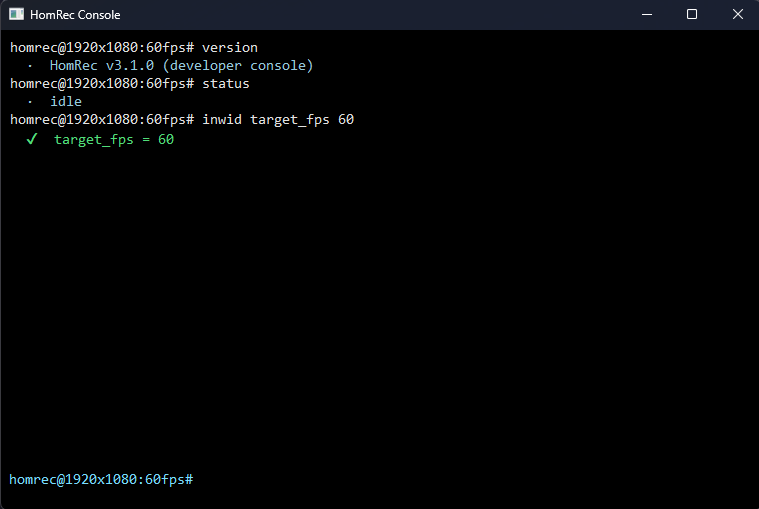

# Developer console and `cfg/` scripts

Open the console with **Help > Console** or `Ctrl+Shift+T`. It is a small command line inside HomRec for
settings, presets, logs and the plugin package manager. This page matches **HomRec 3.1.0**.



## Basics

- One command per line. A command word is not case-sensitive.
- `&&` only works inside `batch`. Typed alone it is refused with `"&&" only chains commands inside "batch"`.
- Many commands **take no arguments**. If you add some, they are refused instead of silently ignored.
- A bare setting name shows its current value: `target_fps` prints `target_fps = 30`.
- An unknown word ends with `Unknown command: <word>` unless a plugin or a setting claims it.

## The `inwid` confirmation prefix

Risky actions are blocked until you put **`inwid`** ("I know what I'm doing") in front of them:

```
inwid <command...>
sudo  <command...>      (same thing)
```

What needs it:

| Action | Example |
|---|---|
| Setting a value | `inwid target_fps = 60` |
| Switching a preset | `inwid preset gaming` |
| `rm` (all forms) | see [rm](#rm-delete-things) |
| `hom` changes: `update`, `restore`, `remove`, `uninstall`, `purge`, `autoremove`, `set`, `repo add/set/use/remove`, anything with `--run` or `--to` | `inwid hom remove myplugin` |

A blocked command prints: `blocked - needs the "inwid" confirmation prefix (I Know What I'm Doing). Run: inwid ...`
(or `<setting>: blocked - setting a value needs the "inwid" confirmation prefix`).

Lines inside `cfg\` scripts run as confirmed, so they do **not** need `inwid`.

### Security switches

| Command | Meaning |
|---|---|
| `sec [0\|1]` | Master protection. `0` disables **all** protections. No value shows the state. |
| `secui [0\|1]` | UI protection. |
| `secp [0\|1]` | Plugin version check and RAM watchdog. |

With `sec` on (the default), "sensitive" settings (for example `custom_ffmpeg_args`, `post_record_hook_path`) and the
core `rm` forms are blocked: `blocked - protected by core security (run "sec 0" first if you trust this)`. Turn it on
again with `sec 1` when you are done.

## Command reference

### Information

| Command | What it does |
|---|---|
| `version` | `HomRec v3.1.0 (developer console)` |
| `ver` | Just the version number (for scripts). |
| `whoami` | Confirms which console and build answer. |
| `ping` | Prints `pong`. |
| `info` | CPU cores, RAM, and whether ffmpeg was found. |
| `status` | `idle`, or `RECORDING` / `PAUSED` with the time and size. |
| `pwd` | The HomRec folder. |
| `ls` | Lists session aliases and env vars. `ls .` lists the HomRec folder; `ls plugins/<name>.hrp` lists a plugin package; `ls --help`. |

### Output and session

| Command | What it does |
|---|---|
| `echo [--ok\|--warn\|--err] text` | Prints text, optionally coloured. |
| `clear` | Clears the console window. |
| `env`, `env NAME`, `env NAME=VALUE` | List, read or set session variables (lost when HomRec closes). |
| `alias name=target` | Define an alias; `alias` alone lists them. |
| `history`, `history clear` | Show or clear the history. `console_history_save 0` turns saving off. |
| `clip --copy "text"` / `--paste` / `--clear` | Windows clipboard. |
| `repeat --count=N <command>` | Run a command N times (maximum 1000). |
| `batch cmd1 && cmd2 [-x]` | Run commands in order. `-x` / `--stop-on-error` exists, but in this build most commands do not report failure, so it does not reliably stop. |

### Logs and window

| Command | What it does |
|---|---|
| `log <message>` or `log -- <message>` | Writes a line into `homrec.log`. |
| `log open` | Opens `homrec.log` in your text editor. |
| `log clear [--all \| --homrec --pc --plugins --wgc --ffmpeg]` | Empties log files; no flag = `homrec.log` only. |
| `hide` | Hides the main window to the tray. |

### Settings files and presets

| Command | What it does |
|---|---|
| `hrc save [path]` / `hrc load [path]` | Save or load settings. Default path `homrec_config.hrc` next to `hr.exe`. `load` skips sensitive fields unless `sec 0`. |
| `preset` | Lists presets in `presets\`. |
| `inwid preset <name>` | Switches. `preset main` / `preset default` returns to `homrec.hrc`. |
| `sethrc <path> <1\|0>` | Merges an `.hrc` into the running settings when the flag is `1`. Meant to be the first line of `cfg\config.cfg`, for example `sethrc homrec.hrc 1`. `custom_ffmpeg_args` is not imported while `sec` is on. |

### Package manager

`hom <args>` forwards to `hom.exe`. See [../hom/usage.md](../hom/usage.md).

### rm (delete things)

> **Dangerous.** These commands delete files. They always need `inwid`, `-r` and `sec 0`.

| Form | Effect |
|---|---|
| `inwid rm --system@homrec.files --permission=core --type={...} -r` | Deletes whole **folders next to `hr.exe`** chosen by `--type`: recordings, plugins, logs, cache. |
| `inwid rm @homrec -r -y` | HomRec **deletes itself** when the process exits. |

Notes, verified in the code:

- `--type=recordings` deletes the folder named `recordings` **next to `hr.exe`**, not the *Output folder* you set in
  Settings. If your output folder is elsewhere, the command does not touch it.
- An unknown `--type` entry stops with `unknown --type entry`.
- Other `rm` forms print `rm: this form isn't supported yet.`

## Settings from the console

Every setting that has a key can be read and (with `inwid`) changed:

```
target_fps                 -> target_fps = 30
inwid target_fps = 60      -> target_fps = 60
```

The value is written to the settings file immediately. `auto_pause_on_silence`, `replay_buffer_sec` and the rest of the
keys are listed in [../hr/settings-reference.md](../hr/settings-reference.md).

Key bindings to console commands are created in **Settings > Hotkeys**.

## `cfg\` scripts

Two optional files in `cfg\` next to `hr.exe`:

| File | Runs |
|---|---|
| `autoexec.cfg` | When HomRec starts. |
| `startrec.cfg` | Every time a recording starts. |

Format: one console command per line; blank lines ignored; lines that start with `//` or `#` are comments. The leading
`$` or `!` is optional. Missing files are not an error. `cfg\autoexec.cfg.example` and `cfg\startrec.cfg.example` show the
format. Two other files live there too: `hom_repos.cfg` (hom download sources) and `console_history.txt`.

```
// cfg\autoexec.cfg
echo HomRec starting up
alias q hide
target_fps = 30
```

A `cfg\` line runs as confirmed, so `target_fps = 30` works without `inwid`.

## Plugins and the console

A plugin can add commands (`homrec.register_command`) and claim setting names. They are tried after the built-in
commands and before `Unknown command`. See [../hr/plugins.md](../hr/plugins.md).

## What can go wrong

| Message | Meaning | Fix |
|---|---|---|
| `blocked - needs the "inwid" ...` | Risky action without the prefix. | Run it again with `inwid`. |
| `blocked - protected by core security` | A sensitive setting or `rm` with `sec` on. | `sec 0`, do it, then `sec 1`. |
| `usage: ...` | Wrong arguments. | Read the usage text. |
| `<key>: invalid value '...'` | The value is not valid for that setting. | Check [settings-reference.md](../hr/settings-reference.md). |
| `Unknown command: ...` | No such command, plugin command or setting. | Check the spelling; check `plugins.log`. |
| `couldn't open ... (no default text editor associated with .log?)` | `log open` has no editor. | Associate `.log` with a text editor. |
| `cfg/autoexec.cfg: unable to decode file, skipped.` | The file is not UTF-8/ANSI text. | Re-save it as UTF-8. |
