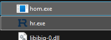
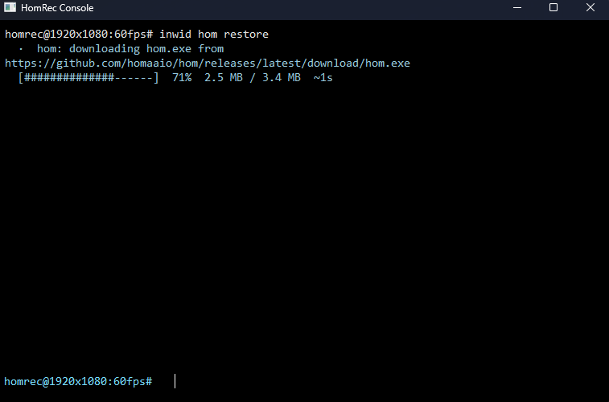

# Installing hom

Three ways. Choose the first that applies.

## 1. It is already there

The **full** portable archive and, if the maintainer bundled it, the installer include `hom.exe` next to `hr.exe`
(**checked**: the packaging scripts add a `hom.exe` when one sits in the repository root; the portable archive is
described as containing it).

**Check:** in the HomRec program folder (**File > Open Program Files**) you see `hom.exe`. If yes, go to
[Verify](#verify).




## 2. Let HomRec download hom

1. Open the HomRec console: `Ctrl+Shift+T`.
2. Run:

   ```
   hom restore
   ```

   (`hom repair` is the same.) HomRec downloads `hom.exe` from the latest release at
   <https://github.com/homaaio/hom/releases> and puts it next to `hr.exe`. The console shows
   `hom: downloading hom.exe from <url>` and a progress bar.
3. If you skip this step and just type any other `hom` command while `hom.exe` is missing, HomRec says
   `hom: hom.exe not found in <folder> - downloading it again.` and does the same.




## 3. Download by hand

1. Open <https://github.com/homaaio/hom/releases>.
2. Download `hom.exe` from the newest release.
3. Put it **next to `hr.exe`** (not in a sub-folder).

Do this when the automatic download fails (no internet access from HomRec, a proxy, a firewall).

## Verify

In the HomRec console:

```
hom --version
```

**Check:** it prints a version number. Then try `hom ping` (older docs: tests the connection to the package source).

Outside HomRec, open `cmd`, change to the HomRec folder and run `hom.exe --version`.

To run `hom` from any folder, add the HomRec folder to your `PATH`
([../hr/cli.md](../hr/cli.md#install) shows how). When you do that, remember that hom installs into **the folder you run
it from** (`.\plugins\`), so run it from the HomRec folder when you want plugins for HomRec (older docs and **checked** for
the console).

## Update hom

```
inwid hom update
```

This replaces `hom.exe` itself with a newer one (needs `inwid`, **checked**). You can instead run `hom restore`.

## Remove hom

Delete `hom.exe`. Plugins you installed stay in `plugins\`. Remove those with `hom remove` first if you want them gone
([usage.md](usage.md)).

## If it fails

| Symptom | Cause | Fix |
|---|---|---|
| `hom: couldn't download <url>` followed by `check your connection, or copy hom.exe next to hr.exe by hand` | No internet, proxy or firewall. | Install by hand (way 3). |
| Windows or the antivirus blocks `hom.exe` | New unsigned program. | Allow it, or add the HomRec folder to exclusions. |
| `hom: couldn't start <path>` | The file is damaged or blocked. | `hom restore`, or download again. |
| `hom` shows `Unknown command: hom` | A very old HomRec. | Update HomRec. |

More: [troubleshooting.md](troubleshooting.md).
