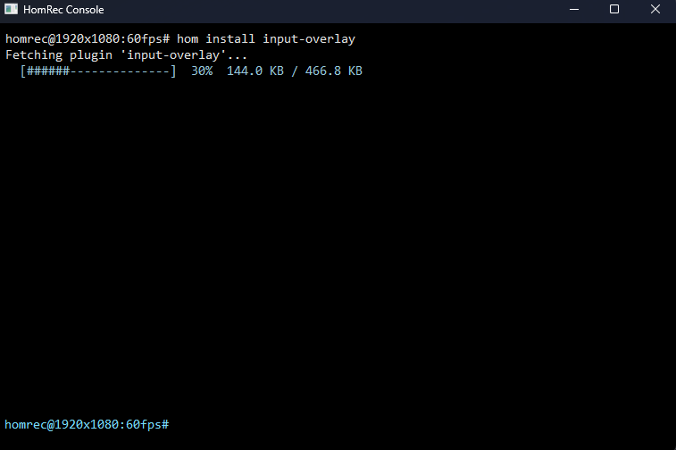

# Using hom

Run these in the HomRec console (`Ctrl+Shift+T`) as `hom <command>`, or in a terminal inside the HomRec folder as
`hom.exe <command>`.

> **Reliability tags.** **checked** = confirmed by the HomRec 3.1.0 source. **older docs** = from the hom 0.4
> documentation; hom is now 0.6.1, so verify with `hom --help`.

## Commands

| Command | What it does | Source |
|---|---|---|
| `hom --version` | Prints the hom version. | older docs |
| `hom ping` | Tests the connection to the package source. | older docs |
| `hom search <query>` | Searches package names and descriptions. | older docs |
| `hom show <name>` | Version, author, description, size, and whether it is installed. | older docs |
| `hom list --installed` | Plugins found in `.\plugins`. | older docs |
| `hom list --upgradable` | Only those with a newer version available. HomRec runs this by itself at startup. | **checked** |
| `hom install <name>` | Downloads a plugin into `plugins\`. HomRec loads it at the next start. Options: `-y`, `-f/--force`. | **checked** (works in the console), options older docs |
| `hom install <name> --to <folder>` | Writes into any folder. Needs `inwid`. | **checked** (gated) |
| `hom install <name> --run` | Starts a downloaded installer. Needs `inwid`. | **checked** (gated) |
| `hom upgrade [-y]` | Re-downloads every installed plugin. | older docs |
| `hom remove <name> -r` | Removes the plugin's code, keeps its saved settings. Needs `inwid`. | gated: **checked**; `-r`: older docs |
| `hom purge <name> -r` | Removes the code **and** saved settings. Needs `inwid`. | gated: **checked**; `-r`: older docs |
| `hom autoremove` | In 0.4 it did nothing. Needs `inwid`. | gated: **checked** |
| `hom update` | Replaces `hom.exe` with a newer one. Needs `inwid`. | **checked** (gated) |
| `hom set ...` | Changes where hom installs to. Needs `inwid`. | **checked** (gated) |
| `hom repo [list]` | Shows package sources. | **checked** (read-only) |
| `hom repo add\|set\|use\|remove ...` | Changes where packages are downloaded from. Needs `inwid`. | **checked** (gated) |
| `hom restore` / `hom repair` | Downloads `hom.exe` again. Handled by HomRec itself, not by `hom.exe`. | **checked** |

"Needs `inwid`" means the HomRec console refuses it until you write `inwid hom ...`
([../commands/Commands.md](../commands/Commands.md#the-inwid-confirmation-prefix)). That gate is HomRec's, and it applies
only when you type the command in the HomRec console.

## Step by step: install a plugin

1. `hom search overlay`
2. `hom show <name>`: read the author and size.
3. `hom install <name>`
4. Restart HomRec, or use **File > Import Plugin (.hrp)...** if you have the `.hrp` file.
5. Open `logs\plugins.log` (Settings > Security > Plugin logging). You should see `<name>: loaded`.

**Check:** `hom list --installed` lists it, and `plugins\` contains the file.

## Step by step: update plugins

1. `hom list --upgradable`
2. `hom upgrade`
3. Restart HomRec.

## Step by step: remove a plugin

1. `inwid hom remove <name> -r` keeps its saved settings so a reinstall picks them up.
2. `inwid hom purge <name> -r` deletes the settings too.

## Progress and output

In the HomRec console, hom runs with `--progress=lines` so downloads show as one live bar (**checked**). Only one `hom`
command runs at a time: a second one is refused with `hom: the previous hom command is still running`. A command is
stopped if it prints nothing for **30 seconds**, and after **15 minutes** in total (**checked**).

## Package sources

hom downloads from a package list. HomRec keeps the sources in `cfg\hom_repos.cfg` (plain text, editable). `hom repo`
manages them. `hom restore` does **not** use these sources: it always downloads from the latest hom release (**checked**).

## Safety

- Plugins are code. Use sources you trust, and read `hom show` output.
- Older hom docs say plugin names containing `..`, a path separator or a drive letter are rejected, so a name cannot
  point outside `.\plugins\`.
