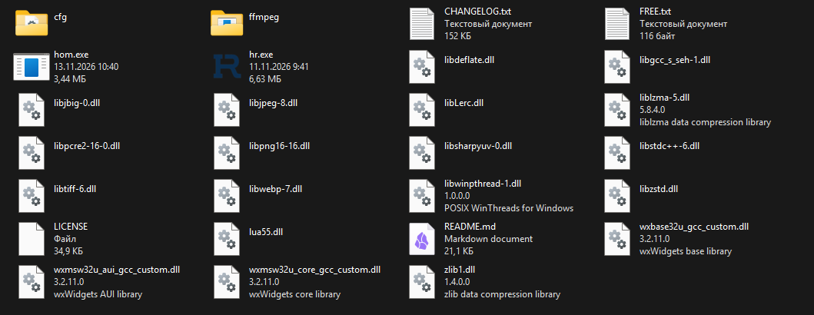

# HomRec documentation

These pages describe **HomRec 3.1.0**. Every statement was checked
against the source code of that snapshot; where something could not be checked it says so.

New to HomRec? Read [getting-started.md](getting-started.md), then [how-it-works.md](how-it-works.md).
Something is broken? Go straight to [troubleshooting.md](troubleshooting.md).

## Which page do I need?

| I want to... | Read |
|---|---|
| Install HomRec and make my first recording | [getting-started.md](getting-started.md) |
| Understand what happens between "Start" and the finished file | [how-it-works.md](how-it-works.md) |
| Record a monitor, a window or a screen region | [capture-sources.md](capture-sources.md) |
| Set up the microphone, desktop sound, per-app audio | [audio.md](audio.md) |
| Add a text, image, GIF, webcam or key-press overlay | [overlays-and-scenes.md](overlays-and-scenes.md) |
| Save "the last 30 seconds" with a hotkey | [instant-replay.md](instant-replay.md) |
| Look up what a setting does | [settings-reference.md](settings-reference.md) |
| Choose a video codec / fix NVENC, AMF, QSV | [codecs.md](codecs.md) |
| Fix a recording that fails or has errors in the log | [recording-troubleshooting.md](recording-troubleshooting.md) |
| Fix anything else, by symptom | [troubleshooting.md](troubleshooting.md) |
| Find logs, crash dumps, and prepare a bug report | [logs-and-diagnostics.md](logs-and-diagnostics.md) |
| Use the developer console and `cfg/` scripts | [../commands/Commands.md](../commands/Commands.md) |
| Write or install a Lua plugin | [plugins.md](plugins.md) |
| Record from a terminal (`homrec.exe`) | [cli.md](cli.md) |
| Build HomRec from source | [building.md](building.md) |
| Install plugins with the package manager | [Hom documentation](../hom/README.md) |

## Where HomRec keeps its files

Everything lives **next to `hr.exe`** (the "program folder"). Open it with **File > Open Program Files**.

| Path (relative to `hr.exe`) | What it is |
|---|---|
| `homrec.hrc` | Your settings. Plain text, safe to back up. |
| `presets\` | Named settings profiles (File > Set Preset...). |
| `scenes\` | Scene files with the layers and overlays (`scene_*.hrc`). |
| `plugins\` | Lua plugins (`.hrp` packages or folders). |
| `cfg\` | Console startup scripts (`autoexec.cfg`, `startrec.cfg`), console history. |
| `logs\` | `homrec.log` and the other logs. See [logs-and-diagnostics.md](logs-and-diagnostics.md). |
| `crashes\` | `.dmp` crash reports. |
| `ffmpeg\ffmpeg.exe` | The encoder. Only present in "full" downloads. |
| `hom.exe` | The plugin package manager (optional). |

Your **recordings** go to the *Output folder* from Settings > General. That folder is never deleted by an
uninstall.

## Conventions used in these pages

- `Settings > Video & Codec` means: menu **Settings > Preferences**, then the tab **Video & Codec**.
- Paths use backslashes (`logs\homrec.log`) because HomRec is Windows-only.
- "Log" means `logs\homrec.log` unless another file is named.
- A **Check** block tells you how to confirm that a step worked. If the check fails, do not continue; use the
  **If it fails** table under it.
