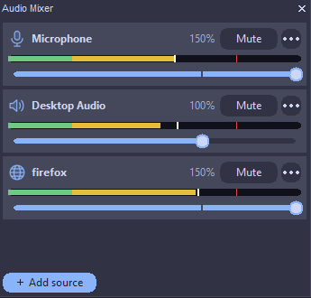
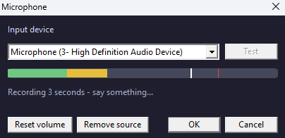
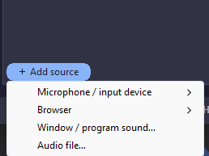

# Audio: microphone, desktop sound and extra sources

How HomRec records sound, how to set it up, and how to find out why a source is silent.

## How it works

Sound is recorded and mixed **live** while you record, then sent to the encoder, so the file already contains it
when you press Stop. If the live mixer cannot start, the sound is captured separately and merged into the video at
Stop (this needs ffmpeg; see [how-it-works.md](how-it-works.md#step-4-press-stop)).

| Source | What it records |
|---|---|
| **Microphone** | The chosen input device (or *System Default*). |
| **Desktop Audio** | Everything Windows plays through its default output device (WASAPI loopback). |
| **Extra sources** (up to **32**) | Another microphone, a browser, one program's sound, or an audio/video file. |

The **Audio Mixer** panel shows one strip per source: a level bar, a volume slider and a mute button. Each strip has
a context menu: **Reset volume to 100%**, **Reconnect now**, **Rename source**, **Remove source**.

## Set it up, step by step

### Microphone

1. In **Settings > Audio**, choose the **Input device** (*System Default* follows Windows).
2. Click **Test**. HomRec records 3 seconds ("Recording 3 seconds - say something...") and plays it back
   ("Playing back what was recorded..."). Use headphones to avoid an echo.
3. Check the level bar in the mixer while you speak.

**Check:** you hear yourself in the test and the Microphone bar moves.

The input device cannot be changed or tested while a recording is running. Stop first.

### Desktop audio

Nothing to choose: it follows the Windows default output device. Play any sound and the **Desktop Audio** bar should
move. If you switch the default output device during a recording, use **Reconnect now** on that strip.

### Extra sources

Click **+ Add source**:

| Entry | Use for | Notes |
|---|---|---|
| **Microphone / input device** | A second microphone | Lists every input device. |
| **Browser** | One browser's sound | Greyed out as *(no browser is running)* when none is open. |
| **Window / program sound...** | Only one program's sound (game voice chat, a music player) | *(needs Windows 10 version 2004 or newer)*. |
| **Audio file...** | A backing track | `.mp3 .wav .flac .ogg .opus .m4a .aac .wma .mp4 .mkv .webm`. Decoded with ffmpeg first. |

In the Settings > Audio tab you can also set the **sample rate** (default 44100 Hz), **AAC bitrate** (default 192 kbps),
**channels** (default 2), tick **Also save audio as a separate MP3** and choose the mixer's refresh rate and layout.

Volume: drag the slider; `Ctrl` + mouse wheel changes it by 5%; double-click returns to 100%.

## Silence detection

Optional keys in `homrec.hrc` (section `[recording_extra]`, also changeable from the console):

| Key | Meaning | Default |
|---|---|---|
| `auto_pause_on_silence` | Pause the recording when the microphone is silent | off |
| `silence_threshold_db` | Level below which it counts as silence | -40 |
| `silence_duration_sec` | How long it must be silent | 3 |

## What can fail

| Symptom | Cause | Fix |
|---|---|---|
| Mic bar flat, test says "Couldn't record from this device." | The device is disabled, in use in exclusive mode by another app, or blocked by Windows privacy settings. | Windows Settings > Privacy & security > Microphone: allow desktop apps. Close the program that holds the mic. Pick another device. |
| Mic bar moves, but the file has no mic | The strip is muted, or the recording used a different device. | Check the mute button; recheck the device in Settings > Audio. |
| `(no input devices found)` | Windows reports no recording device. | Plug in or enable one in Windows Sound settings. |
| Desktop Audio flat | Nothing is playing to the default output, or the default output changed. | Play a sound; use **Reconnect now**. |
| Program-sound entry is greyed out | Windows older than 10 version 2004. | Use *Desktop Audio* instead. |
| *No windows with sound-capable programs were found.* | The program is not running or makes no sound yet. | Start the sound first, then add the source. |
| "That's the maximum number of extra audio sources (32)." | Limit reached. | Remove one. |
| Audio file source silent; log: `Audio Mixer: ffmpeg not found - can't prepare '...'` or `couldn't decode '...'` | ffmpeg missing, or the file is not decodable. | [getting-started.md](getting-started.md#2-pick-a-download); convert the file to `.wav`. |
| Sound out of sync with the picture | Very high CPU or GPU load. | [troubleshooting.md](troubleshooting.md#the-recording-stutters-or-the-game-loses-fps). |
| After Stop, the video has no sound and a `.wav` file sits next to it | The merge step failed. | Merge with ffmpeg by hand, and check free disk space. |

Extra sources are **not** included in Instant Replay ([instant-replay.md](instant-replay.md)).

For the log lines of the mixer, search `logs\homrec.log` for `Audio Mixer:`.
