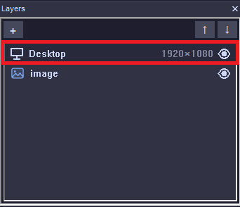

# Capture sources: desktop, monitor, window, region

What HomRec can record, how to choose it, how window recording works, and what to do when the picture is wrong.

## Choosing the source

The **first row of the Layers panel** is the capture source. **Double-click it** to open the **Capture source**
window. You cannot change the source while a recording is running ("A recording is running - it keeps the source it
was started with"). Stop first.

| Option (in the dialog) | Records | Good for |
|---|---|---|
| **The whole desktop** + a *Monitor* | One monitor, or the main one. | Games, tutorials, anything that moves between windows. |
| **One window** | A single program's window. | Hiding the rest of your desktop. |
| **A region of the screen** | A rectangle you draw. | A small part of the screen. |

<!-- IMG: hr-capture-source-dialog -->

The Layers panel also lets you add **Window** and **Region** *layers* on top of the main source, to build a picture
from several pieces (see [overlays-and-scenes.md](overlays-and-scenes.md)).

## Desktop and monitors

1. Open the Capture source window and choose **The whole desktop**.
2. Pick the **Monitor**. The main one is marked `(main)`.
3. Click **OK**.

HomRec records the picture Windows gives it for that monitor (DXGI Desktop Duplication). Unchanged screens cost almost
nothing: frames are only sent to the encoder when the picture changes.

### If it fails

| Symptom | Cause | Fix |
|---|---|---|
| The preview says *Screen capture unavailable - check you're not on RDP/a virtual display, and that the selected monitor is connected* | Remote Desktop session, a virtual display, or the chosen monitor is gone. | Record on the physical session; re-select an existing monitor. |
| Black picture | Not specific to HomRec, so these are the usual suspects: a laptop with two GPUs, a protected (DRM) video surface, or a program running as administrator on top of the capture. | Try HomRec on the other GPU (Windows Settings > System > Display > Graphics); for an elevated program, start HomRec as administrator. This was not reproduced for this guide, so tell us the log if it persists. |
| Frozen picture after a game changes resolution | The display mode changed under the capture. | Stop and start again. In ddagrab mode the recording continues in a new file and HomRec unticks the option ([codecs.md](codecs.md)). |
| Wrong monitor recorded | The monitor numbering changed (a screen was plugged in or removed). | Re-open the Capture source window and select it again. |

## Recording one window

1. Open the Capture source window and choose **One window**.
2. Click **Pick window...**, select the window in the list and press **Record this window**.
3. Under **How to find the window again**, tick the rules that must all match: **Program** (the `.exe`), **Window
   class**, **Title** (*is exactly*, *starts with*, or *contains*). Tick **Keep recording the same window while it
   exists** if the title changes.
4. Click **Test: find it now**. You should see `Found: '<title>' (<exe> / <class>)`.
5. Click **OK**.

<!-- IMG: hr-capture-window-rules -->

> Tip from the dialog itself: for a **browser**, keep *Program* ticked and *Title* off, because the title changes
> with every tab.

### How the window is recorded

| Choice | What it means | Cost |
|---|---|---|
| **The window itself** | Uses Windows' own window capture (Windows Graphics Capture, falling back to a compatible PrintWindow method). Windows on top of it do **not** appear in the recording. | Higher. |
| **A part of the screen** (screen crop) | Cuts the window's rectangle out of the screen. Anything on top of the window is recorded too. | Lowest. |
| **Smart mode** | Uses the cheap screen crop while nothing covers the window, and the exact window capture only while something lies on top. | Low to medium. |

Other options: **Whole window** (with title bar and borders) or **Only the content area**; a **frame-rate limit** for
the exact capture (0 = same as Target FPS).

The dialog shows **Right now:** which method is active: *native Windows capture*, *exact window capture
(PrintWindow)* or *smart mode - reading the screen*.

If the window is resized while recording, the picture is fitted into the recording's fixed size (aspect ratio kept,
black bars).

### Things that cannot be captured by the window method

- A window of a program **running as administrator** cannot be captured by a normal HomRec. The screen crop is used
  instead.
- A **minimised** window produces no new frames.
- Windows older than Windows 10 **1903** do not support the native capture. The screen crop is used.

### If it fails

| Symptom | Cause | Fix |
|---|---|---|
| "The window you selected (...) is not on any screen right now, so it can't be recorded." at Start | The window is closed, minimised, or on a disconnected monitor. | Open it and press Start again, or re-pick it. |
| *Not found right now (closed or minimized?)* after **Test** | The rules do not match the window now. | Untick *Title*, or use *contains*; keep *Program* ticked. |
| *Pick a window first* / *Tick at least one way to find the window* | The dialog needs a target and at least one rule. | Pick a window and tick one rule. |
| Window recording uses the screen crop even though you chose the window | HomRec's crash guard: the previous run crashed inside native window capture, so it is switched off. | Click **Try the native Windows capture again...** in the dialog. If it crashes again HomRec disables it at the next start. Details in `logs\wgc.log` ([logs-and-diagnostics.md](logs-and-diagnostics.md)). |
| Other windows appear in the recording | You chose *A part of the screen*, or the admin/crop fallback was used. | Choose *The window itself*, or use *Smart mode*. |
| Black window | Some programs (DRM video, some games) refuse capture. | Use the desktop source instead. |

To turn on detailed window-capture logging: **Settings > Security > Window capture logging**. The log is `logs\wgc.log`.

## Recording a region

1. Choose **A region of the screen**.
2. Click **Select region...** and drag a rectangle on the screen.
3. Click **OK**. *Select a region first* appears if no rectangle was drawn.

If the region is no longer on any monitor at Start (a screen was unplugged), recording refuses to start with "The
region you selected is no longer on any screen".

## Hide some windows from the recording

**File > Hide Windows From Recording...** lets you double-click a window to hide it from any screen capture (HomRec's
and other tools'). It stays normal on your own screen. **Show all (clear)** restores everything. Use it for password
managers, chat windows and notifications.

<!-- IMG: hr-capture-hide-windows -->

## Full-GPU capture (ddagrab)

An experimental setting (**Settings > Video & Codec > GPU acceleration**) lets ffmpeg capture and encode entirely on
the GPU. It cannot be used together with HomRec overlays or plugins, pause or silence auto-pause, window tracking, or a reduced
output resolution; HomRec then quietly uses the normal pipeline. See [codecs.md](codecs.md) and
[how-it-works.md](how-it-works.md#which-path-does-the-video-take).

## When the source is lost

If the capture source is lost during a recording (a graphics device reset, a monitor change), the capture engine
reports "source lost" and HomRec tries to rebuild the capture. If the picture stays frozen, stop the recording and
start a new one. Check `logs\homrec.log` and `logs\wgc.log` for lines about the capture.
