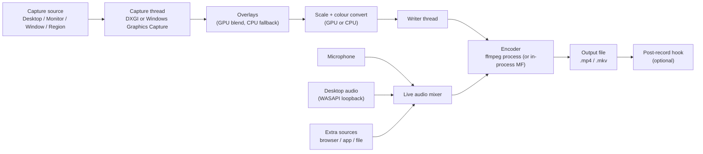

# How HomRec works

A step-by-step walk through everything that happens from launching HomRec to the finished file, with the things
that can go wrong at each step. Use it to understand a log, or to find out where a problem starts.

## The big picture

| Part | What it does | Where it lives |
|---|---|---|
| UI | Window, panels, settings, console | `hr.exe` (wxWidgets) |
| Capture | Gets desktop or window frames from Windows | `hr.exe` (DXGI Desktop Duplication, Windows Graphics Capture) |
| Pipeline | Skips unchanged frames, draws overlays, converts colour, hands frames to the encoder | `hr.exe` |
| Encoder | Compresses video (and audio) into a file | `ffmpeg.exe` as a separate process |
| Audio | Records microphone and desktop sound, mixes them live | `hr.exe` (WASAPI) |
| Plugins | Lua scripts that react to events | `hr.exe` (Lua 5.4) |

Two things to remember:

1. **HomRec does not encode by itself.** It captures; `ffmpeg.exe` compresses. No ffmpeg, no recording.
2. **Everything is local and next to `hr.exe`.** Settings, logs and plugins are in the program folder
   ([README.md](README.md#where-homrec-keeps-its-files)).

## Step 1: Launch

| Order | What happens | If it fails |
|---|---|---|
| 1 | A single-instance lock is taken. A second `hr.exe` exits at once. | Nothing opens: look in the tray. |
| 2 | `homrec.hrc` is read. A missing file means defaults. | A broken file: rename it and restart. |
| 3 | A crash handler is installed (writes `crashes\crash_<date>.dmp`). | n/a |
| 4 | `ffmpeg.exe` is located ([search order](getting-started.md#2-pick-a-download)). | The log says so; Start will report "FFmpeg not found." |
| 5 | Video encoders are probed (see below). | A status-bar notice; the log has the reason. |
| 6 | Audio devices are initialised. | Mixer bars stay flat: [audio.md](audio.md). |
| 7 | Plugins in `plugins\` are loaded; `cfg\autoexec.cfg` runs. | Errors go to `logs\plugins.log` / the console. |
| 8 | If `hom.exe` exists next to `hr.exe`, a background `hom list --upgradable` checks for plugin updates (15 s limit). A badge shows the result. | Silent: no badge. |

### The encoder probe

`HW accel` (Settings > Video & Codec) defaults to `auto`:

- With `Codec` = `libx264` and `auto`: HomRec tests `h264_nvenc`, then `h264_amf`, then `h264_qsv` with a very short
  clip (up to 10 s each). The first that works is used **for recordings only**; the `Codec` setting is not changed.
  If none works, `libx264` (CPU) is used.
- With `Codec` set to a hardware encoder: HomRec checks only that one (0.2 s). If it fails you get a notice and a
  log line, and **the setting stays as you chose it**. HomRec never silently swaps your codec.
- `HW accel` = `none` turns the automatic probe off.

Details and causes: [codecs.md](codecs.md).

## Step 2: Press Start

Before anything is captured, HomRec runs these checks in order. The first one that fails stops the start and shows
a message (also in the log as `Start failed: ...`).

| Check | Message |
|---|---|
| Already recording | "Already recording." |
| The previous file is still being saved | "The previous recording is still being saved - try again in a moment." |
| Window source: the window closed or is off-screen | "The window you selected ... is not on any screen right now ..." |
| Region source: the region is off all monitors | "The region you selected is no longer on any screen ..." |
| Output folder | "Output folder doesn't exist and couldn't be created." |
| ffmpeg | "FFmpeg not found." |
| Free disk space (at least **200 MB** on the output drive) | "Not enough free disk space on the output drive ..." |

After the checks, HomRec runs the 3-second countdown (if enabled) and `cfg\startrec.cfg`, chooses the capture path
(next table), and starts the capture thread, writer thread, encoder and audio.

### Which path does the video take?

| Path | When | Log line |
|---|---|---|
| **Normal pipeline + ffmpeg** | The default. | `Recording: encoding with libx264 (software)` or `... with h264_nvenc (hardware)` |
| **Full-GPU ddagrab** | You ticked *Full-GPU capture via ffmpeg ddagrab* (experimental), ffmpeg is 6+, a hardware encoder is in use, and you use no overlays, plugins, reduced resolution or window tracking. | `Recording: full-GPU capture + encode via ffmpeg ddagrab` |
| **In-process Media Foundation** | Experimental, off by default; only through the console / cfg (`mf_encoder=1`), H.264 hardware encoder, MP4 output, no custom ffmpeg arguments. | `Recording: in-process Media Foundation encoder` |

If ddagrab or Media Foundation cannot start, HomRec logs why and continues with the normal pipeline.

## Step 3: While recording

1. **Capture.** The capture thread asks Windows for a new frame. If the screen did not change, no frame is sent
   (static scenes cost almost nothing).
2. **Overlays.** Text, image, GIF, webcam and input overlays are blended onto the frame. With a hardware encoder
   this is done on the GPU; if that is not available the CPU does it.
3. **Convert.** The frame is scaled to the output size and converted to the encoder's colour format. With a hardware
   encoder and *GPU colour conversion* on, the GPU does this and only 1.5 bytes per pixel are read back instead of 4.
4. **Write.** A single writer thread sends frames to the encoder with timestamps. The output is a constant frame rate;
   ffmpeg repeats the last frame across gaps.
5. **Audio.** Microphone, desktop sound and extra sources are mixed live and sent to the encoder through a named pipe,
   so the sound is already in the file when you press Stop.
6. **Stats.** The status bar updates about every half second: elapsed time, file size, frame count.

**Pause** (`F10`): the video timeline and the audio are both paused, and Resume continues. With ddagrab, ffmpeg owns
the capture and cannot be paused, so Pause closes the current ffmpeg piece, Resume starts a new one, and Stop joins
the pieces by a stream copy (no re-encoding). If the `ddagrab_pause` setting is off, Pause is unavailable in ddagrab mode.

**Crash safety.** MKV keeps what was written before a crash or power loss. MP4 written by ffmpeg may be unusable if
it was never finished. If you record long sessions, choose MKV ([codecs.md](codecs.md#settings-that-go-together-with-the-codec)).

### What can go wrong while recording

| Symptom | Usual cause | Where to look |
|---|---|---|
| Recording stops by itself | ffmpeg died (disk full, hardware encoder error, driver) | `ffmpeg exit code` in the log: [recording-troubleshooting.md](recording-troubleshooting.md) |
| Dropped frames, `Recording overloaded` | CPU or GPU cannot keep up | [troubleshooting.md > Lag](troubleshooting.md#the-recording-stutters-or-the-game-loses-fps) |
| Picture frozen | Source lost (resolution change, window closed, remote session) | [capture-sources.md](capture-sources.md#when-the-source-is-lost) |
| Sound missing from one source | Device removed or muted | [audio.md](audio.md) |

## Step 4: Press Stop

| Order | What happens | Log line |
|---|---|---|
| 1 | The live audio mixer ends. | `Recording: Stop - ending the live audio mixer.` |
| 2 | Capture and writer threads stop. | `Recording: Stop - closing the recording segment.` / `... stopping the capture and writer threads.` |
| 3 | The encoder finishes the file. HomRec waits 10 s and warns, then gives up at 30 s. | `Recording: ffmpeg is still finalizing the output after 10s` |
| 4 | If the audio could not be mixed live, it is merged into the video now (needs ffmpeg). | `Recording: merging the captured audio ...` |
| 5 | *Also save audio as a separate MP3*: the MP3 is exported. | `Recording: separate audio saved -> ...` |
| 6 | *Both* output format: an `.mp4` copy of the `.mkv` is made. | `Recording: also saved an .mp4 copy -> ...` |
| 7 | The post-record hook runs (open folder, move the file, or launch a script). | `Recording: post-record hook ...` |
| 8 | The summary and `on_recording_stop` plugin hooks run. | |

Saving a long recording can take several seconds. **Do not close HomRec until the status shows idle.**

### What can go wrong at Stop

| Log line | Meaning | Fix |
|---|---|---|
| `ffmpeg didn't finish on its own after 30s` | The encoder hung. The file may be damaged. | Record in MKV; check the disk and the encoder. |
| `couldn't mix the microphone and system audio` | The mix failed. The system-audio WAV is kept next to the recording. | Merge it with the video by hand using ffmpeg. |
| `merging the captured audio into the video failed` | The video is kept without sound; the audio WAV is kept next to it. | Same; check free disk space. |
| `couldn't create the .mp4 copy - the .mkv is intact` | The copy failed, the `.mkv` is fine. | Convert it later. |

## Instant Replay in one paragraph

Instant Replay runs a **second, separate encoder** that keeps the last N seconds in RAM (default limit 1024 MB).
Press `F8` and the buffer is written to a file. It is independent from normal recording. Full guide:
[instant-replay.md](instant-replay.md).

## Plugins and the console

Plugins (Lua) are loaded at startup and receive events (`on_recording_start`, `on_replay_saved`, ...). The console
(`Ctrl+Shift+T`) runs commands and the `cfg\` scripts. See [plugins.md](plugins.md) and
[../commands/Commands.md](../commands/Commands.md).

## Quick map: stage to document

| Stage | Document |
|---|---|
| Install, first run | [getting-started.md](getting-started.md) |
| Capture source problems | [capture-sources.md](capture-sources.md) |
| Sound | [audio.md](audio.md) |
| Encoder / codec | [codecs.md](codecs.md) |
| ffmpeg exit codes | [recording-troubleshooting.md](recording-troubleshooting.md) |
| Everything else | [troubleshooting.md](troubleshooting.md) |
